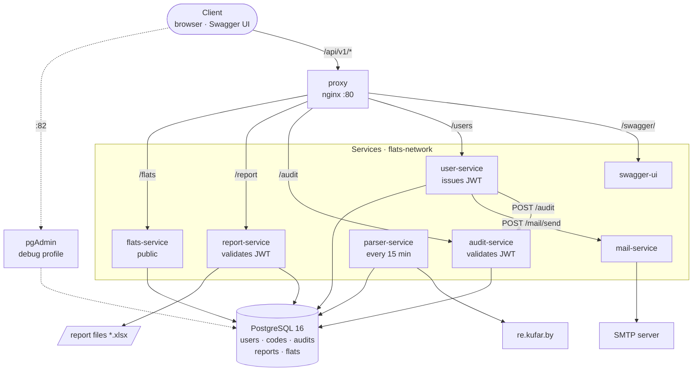
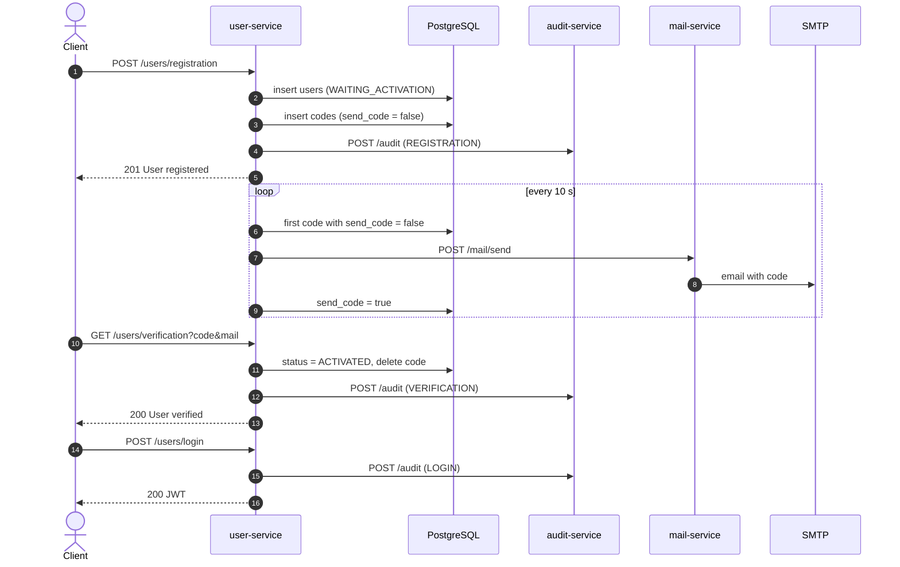
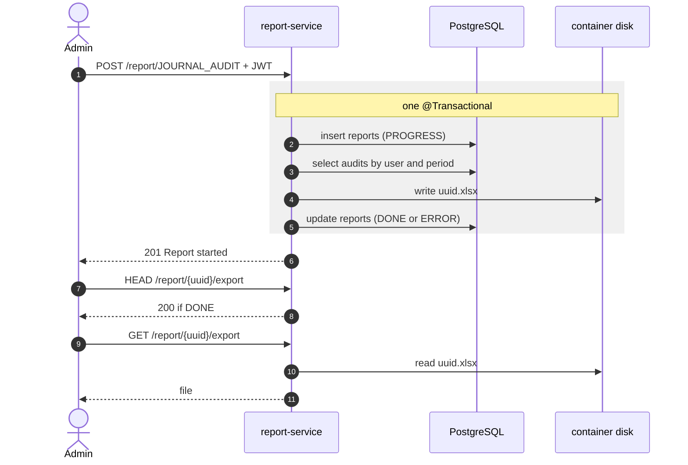

# Description

Web application based on microservice architecture style. It grants information about relevant flat rent and sale options.

# How to run

To start the application, follow these steps:

### 1. Clone the repository

Clone project repository by this command:

```bash
git clone https://github.com/L1BER2Y/apartments_search.git
```
### 2. Fill environment variables

```bash
cp .env.example .env
```

### 3. Next, go to the root directory and start application in docker by following command:

```bash
docker compose up -d
```
### 3.1 With pgAdmin enabled (http://localhost:82)
```bash
docker compose --profile debug up -d pgadmin
```

# Application diagram



**Notes**
- All services share one PostgreSQL database (`user_service`, schema `users`); report-service reads the `audits` table directly.
- user-service → audit-service: Feign call from an AOP aspect on `@Audited` methods.
- user-service → mail-service: verification codes are saved to `codes`, a scheduler sends them every 10 s.
- JWT is issued by user-service and validated locally by audit-service and report-service; flats-service is public.
- Generated `.xlsx` reports are stored on the report-service container filesystem.

## Flows

### Registration, verification, login


### Report generation

All client requests go through proxy (api/v1 prefix is stripped).

# Application microservices:

**[User-service](https://github.com/L1BER2Y/apartments_search/tree/main/user-service)**
- This microservice is responsible for admin (creating/editing users, user information, and user (registering, verification, logging in, user information) functions.
- Also it has user action tracking functionality, that was implemented with the help of Aspect-oriented programming.

**[Flats-service](https://github.com/L1BER2Y/apartments_search/tree/main/flats-service)**
- Flats-service is used to display information about flats.
- You can also specify you request with filters (price, bedrooms, area, floors, photos).

**[Parser-service](https://github.com/L1BER2Y/apartments_search/tree/main/parser-service)**
- This microservice parses info about flats from https://re.kufar.by/ website in real time. 
- Parsed information is stored into application database.

**[Audit-service](https://github.com/L1BER2Y/apartments_search/tree/main/audit-service)**
- Audit-service accepts audited actions from user-service and stores them into database. 
- It has admin feature to check audited actions for chosen user by id.

**[Report-service](https://github.com/L1BER2Y/apartments_search/tree/main/report-service)**
- Service create reports based on user's audited actions.
- It accepts report requests, can display report status, give page of reports, provides created report download link.

**[Mail-service](https://github.com/L1BER2Y/apartments_search/tree/main/mail-service)**
- Responsible for sending verification codes to email addresses during user registration.

# Used technologies and frameworks:
- [Java 17](https://docs.oracle.com/en/java/javase/17/docs/api/)
- [Nginx](https://nginx.org/en/)
- [JUnit5](https://junit.org/junit5/)
- [Docker](https://www.docker.com/)
- [Maven 3.9.6](https://maven.apache.org/)
- [H2 Database](https://www.h2database.com/html/main.html)
- [PostgreSQL 16](https://www.postgresql.org/)
- [Spring Boot 3.2.0](https://spring.io/projects/spring-boot)
- [Spring Security 3.2.0](https://spring.io/projects/spring-security)
- [Spring Data JPA 3.2.0](https://spring.io/projects/spring-data-jpa)
- [Spring Cloud OpenFeign 4.1.0](https://spring.io/projects/spring-cloud-openfeign)

# Future plans:

**Infrastructure & quality**
- [ ] Database migrations with Liquibase instead of `init.sql`
- [ ] Integration tests with Testcontainers (PostgreSQL) instead of H2
- [ ] CI pipeline with GitHub Actions (build, tests, JaCoCo coverage, SonarCloud)
- [ ] Upgrade to Java 21 and Spring Boot 3.5 (virtual threads)

**Architecture**
- [ ] Event-driven communication via Apache Kafka (audit, mail) with Transactional Outbox pattern
- [ ] Database-per-service: remove direct access to audit table from report-service
- [ ] Spring Cloud Gateway with centralized JWT validation, then Keycloak (OAuth2/OIDC)
- [ ] Fault tolerance with Resilience4j (retry, circuit breaker, rate limiter)

**Features**
- [ ] Saved searches and notifications about new flats (Telegram bot / e-mail)
- [ ] Price history tracking and price drop alerts
- [ ] Full-text search over flat descriptions (Elasticsearch)
- [ ] Additional sources besides Kufar (realt.by)
- [ ] Store generated reports in MinIO (S3) with presigned download links
- [ ] Redis caching for popular flat filters

**Observability & deployment**
- [ ] Metrics with Micrometer, Prometheus and Grafana dashboards
- [ ] Distributed tracing (Micrometer Tracing + Zipkin) and centralized logs (Loki)
- [ ] Deployment to Kubernetes with Helm charts
